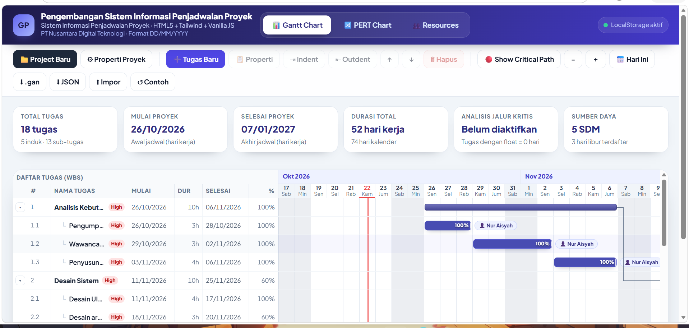
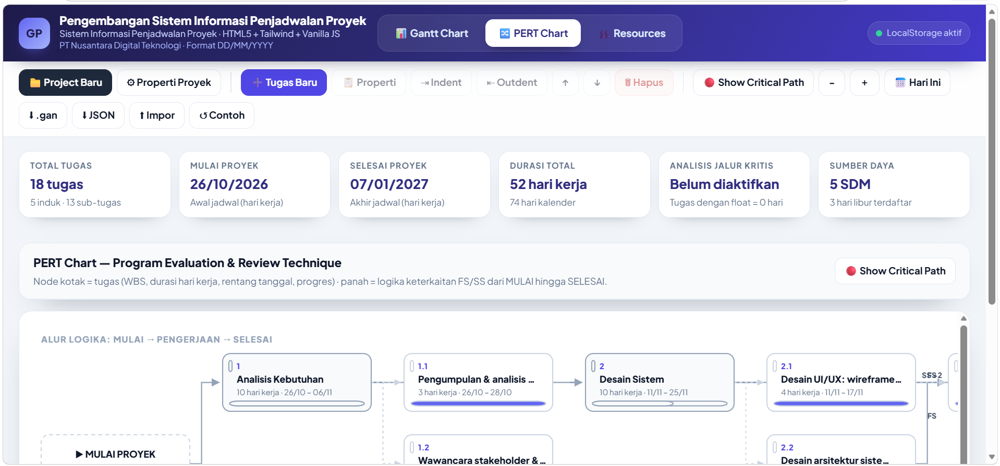

# 📊 GanttProject Web Simulator — Sistem Informasi Penjadwalan Proyek

**Aplikasi web modern, interaktif, dan responsif untuk mensimulasikan alur kerja standar GanttProject — 100% client-side (tanpa server), data tersimpan di LocalStorage.**

Dibangun dengan **HTML5 + Tailwind CSS (via CDN) + Vanilla JavaScript** dan stylesheet modular kustom.
Cukup **klik dua kali `index.html`** — tidak perlu install/build/apapun.

---

## 1. Cara Menjalankan

```bash
# Cara 1 (paling mudah): klik dua kali index.html

# Cara 2 (opsional, disarankan untuk pengembangan)
python -m http.server 8080
# lalu buka http://localhost:8080/
```

> Tailwind CSS & font dimuat dari CDN, sehingga tampilan optimal membutuhkan koneksi internet.
> **Bila offline pun aplikasi tetap berfungsi penuh** — seluruh logika & styling inti ada di `css/style.css` dan JS lokal.
> Jika LocalStorage diblokir browser, aplikasi otomatis beralih ke mode memori (perubahan hanya bertahan selama tab terbuka) dan menampilkan peringatan toast.

### Struktur berkas

```
.
├── index.html            # Tata letak antarmuka lengkap (tab Gantt, PERT, Resources + seluruh modal)
├── css/
│   └── style.css         # Styling modern, clean, responsif (grid Gantt, node PERT, modal, tabel)
├── js/
│   ├── data.js           # Struktur data default (seed WBS), role sets, SDM, kalender, manajemen LocalStorage
│   ├── gantt.js          # Engine render Gantt Chart + kalkulasi tanggal/hari kerja (working-day calendar)
│   ├── pert.js           # Engine visualisasi diagram PERT (node + panah logika)
│   └── app.js            # Event handler, form modal, perhitungan Critical Path (CPM), ekspor/impor
├── hotel/                # 📦 Arsip aplikasi SEBELUMNYA (Sistem Informasi Reservasi Hotel) — buka hotel/index.html
└── README.md             # Dokumen ini
```

---

## 2. Peta Modul ↔ Alur Kerja Standar GanttProject

| No | Modul GanttProject            | Lokasi di Aplikasi                                                                 |
|----|-------------------------------|-------------------------------------------------------------------------------------|
| 1  | **Project → New** (inisialisasi & konfigurasi) | Tombol **📁 Project Baru** / **⚙ Properti Proyek** pada toolbar              |
| 2  | **Task & Sub-Task (WBS)**      | Tombol **➕ Tugas Baru**, **⇥ Indent**, **⇤ Outdent**, **↑ ↓**, **🗑 Hapus**       |
| 3  | **Predecessors (keterkaitan)** | Form **Keterkaitan Tugas** di dalam jendela *Task Properties* (klik batang tugas) |
| 4  | **Resource Chart (SDM)**       | Tab **👥 Resources** + form *Alokasi SDM* di *Task Properties*                      |
| 5  | **Gantt / PERT / Critical Path / Ekspor** | Tab **📊 Gantt Chart**, **🔀 PERT Chart**, tombol **🔴 Show Critical Path**, **⬇ .gan**, **⬇ JSON**, **⬆ Impor** |

---

## 3. Modul 1 — Inisialisasi & Konfigurasi Proyek

Buka **⚙ Properti Proyek** (atau **📁 Project Baru** untuk memulai dari nol).

### 3.1 Identitas Proyek
- **Nama Proyek**, **Nama Organisasi/Perusahaan**, **Deskripsi** — tampil di header aplikasi dan ikut diekspor ke berkas `.gan`.
- **Format Penanggalan**: `DD/MM/YYYY` (default), `MM/DD/YYYY`, `YYYY-MM-DD` — langsung mengubah seluruh tampilan tanggal di Gantt, PERT, dan tabel.

### 3.2 Role Sets (peran baku)
Centang **Default** dan/atau **Software Development** — daftar peran aktif muncul live pada preview dan menjadi isi dropdown **Peran SDM**:

| Role Set              | Peran yang disediakan                                                                 |
|-----------------------|----------------------------------------------------------------------------------------|
| **Default**           | Project Manager, Team Leader, Team Member                                              |
| **Software Development** | System Analyst, UI/UX Designer, Programmer, QA/Tester, Database Engineer, DevOps Engineer |

Keduanya dicentang → kombinasinya menyediakan peran baku: **Project Manager, System Analyst, UI/UX Designer, Programmer, QA/Tester**.

### 3.3 Kalender Kerja & Hari Libur
- **Checkbox Sabtu / Minggu** → menentukan *non-working days* (uncheck = Sabtu/Minggu jadi hari kerja).
- **Custom Holidays**: isi *nama libur*, *tanggal*, centang **Tiap tahun** untuk opsi *recurring* (selain itu *one-off*), lalu klik **＋ Tambah Libur**.
- **Semua perhitungan durasi kerja melewati hari libur ini**: tugas yang jatuh pada hari libur otomatis digeser ke hari kerja berikutnya, durasi dihitung dalam hari kerja murni, dan kolom kalender pada Gantt diberi warna oranye.

> Klik **Simpan Perubahan** — seluruh jadwal otomatis dihitung ulang.

---

## 4. Modul 2 — Manajemen Tugas & WBS

### 4.1 New Task
Klik **➕ Tugas Baru** (atau klik dua kali baris tugas untuk *Task Properties*):

| Field            | Keterangan                                                            |
|------------------|------------------------------------------------------------------------|
| Nama Tugas       | wajib diisi                                                            |
| Tanggal Mulai    | default hari ini                                                       |
| Durasi           | dalam **hari kerja** (melewati weekend & libur)                        |
| Tingkat Prioritas| `Low`, `Normal`, `High` — tampil sebagai badge di daftar tugas         |
| Warna Batang Timeline | 10 pilihan warna swatch                                             |
| Progres (%)      | 0–100 — dirender sebagai pengisian dalam batang Gantt                 |

Jika tugas terpilih adalah **tugas induk**, tanggal/durasi/progres dinonaktifkan karena dihitung otomatis (lihat 4.2).

### 4.2 Hierarki Sub-Tugas (Indent / Outdent)
Pilih tugas (klik barisnya), lalu:

- **⇥ Indent** — tugas bergeser menjadi **anak** dari tugas sebelumnya (sibling sebelahnya).
- **⇤ Outdent** — tugas **keluar** dari induknya dan menjadi saudara induknya.
- **↑ / ↓** — menaikkan/menurunkan urutan antar saudara.
- **🗑 Hapus** — menghapus tugas beserta seluruh sub-tugas & referensi dependensinya.

**Rollup otomatis tugas induk:**

```
Tanggal Mulai induk  = min(tanggal mulai seluruh sub-tugas)
Tanggal Selesai induk= max(tanggal selesai seluruh sub-tugas)
Durasi induk          = akumulasi hari kerja di antaranya
Progres induk         = rata-rata progres sub-tugas
```

- Struktur WBS tampil bernomor klasik: `1`, `1.1`, `1.2`, `2`, `2.1`, …
- Tombol ▾/▸ pada tiap baris membuka/menutup sub-tugas (expand/collapse).

---

## 5. Modul 3 — Keterkaitan & Urutan Tugas (Predecessors)

Di dalam **Task Properties**, bagian *Keterkaitan Tugas*: klik **＋ Tambah Pendahulu**, pilih tugas pendahulu, tipe relasi, dan nilai lag:

| Tipe | Aturan (satuan hari kerja)                                          |
|------|----------------------------------------------------------------------|
| **FS (Finish-to-Start)** | Penerus mulai **setelah** pendahulu selesai + lag         |
| **SS (Start-to-Start)**  | Penerus mulai **bersamaan** dengan pendahulu + lag        |

- **Lag / Delay**: bilangan bulat (boleh negatif) dalam hari kerja.
- Mesin penjadwalan **otomatis memundurkan tanggal mulai** seluruh sub-tugas penerus (dan induknya) agar aturan dependensi terpenuhi — termasuk mendorong seluruh pohon tugas di bawahnya.
- Panah keterkaitan digambar di Gantt (garis putus-putus = SS) dan di PERT (berlabel `FS`/`SS +lag`).
- Dependensi yang membentuk **siklus** dideteksi: jadwal tetap dihitung, edge siklus diabaikan, dan peringatan toast muncul.

---

## 6. Modul 4 — Pengelolaan & Alokasi SDM (Resource Chart)

Tab **👥 Resources**:

- **Tambah SDM**: Nama, Email, Nomor Telepon, **Peran/Jabatan** (mengikuti role set aktif), **Tarif/Biaya** dengan satuan **Rate per hour** atau **Rate per task**.
- Kolom **Tugas Diampu** menampilkan chip seluruh tugas yang menugaskan SDM tersebut (+ jumlahnya).
- Edit / Hapus per baris (hapus SDM juga melepas seluruh alokasinya dari tugas).

**Resource Assignment → badge di Gantt:**
1. Klik batang tugas → *Task Properties*.
2. Centang SDM pada bagian **Alokasi SDM** (boleh lebih dari satu).
3. Setelah disimpan, **nama SDM penanggung jawab otomatis muncul di samping batang tugas** pada Gantt Chart (badge `👤 Nama`).

---

## 7. Modul 5 — Gantt Chart, PERT Chart, dan Analisis Jalur Kritis

### 7.1 Gantt Chart Interaktif
- Grid kalender dua baris (**bulan** + **tanggal/hari**) dengan lebar kolom yang bisa diatur (**− / ＋** zoom, 12–60 px/hari).
- **Batang horizontal** per tugas: warna sesuai pilihan, pengisian **progres %**, label % di dalam batang, badge nama SDM di samping batang.
- **Garis panah** keterkaitan antar tugas (FS solid, SS putus-putus) dengan panah ujung.
- **Warna latar**: abu = weekend, oranye = hari libur custom, garis merah = **hari ini** (tombol **📅 Hari Ini** melompat ke posisinya).
- Baris tugas induk diberi indentasi + nomor WBS; klik = pilih, klik dua kali = buka Task Properties, klik batang = buka Task Properties.
- **Legend** tersemat di bawah grafik.

### 7.2 Show Critical Path
Tombol **🔴 Show Critical Path** menjalankan algoritma **CPM (Critical Path Method)** backward-pass pada indeks hari kerja:

```
LS = LF − durasi + 1
FS : LF(p) ≤ LS(s) − 1 − lag
SS : LF(p) ≤ LS(s) − dur(p) + 1 − lag
Rollup : LF(anak) ≤ LF(induk)
Float  = LS − ES        →   float = 0 ⇒ TUGAS KRITIS
```

- Tugas berdurasi ketat tanpa *slack* (float 0) disorot **merah menyala** (batang berdenyut, panah merah, node PERT merah), termasuk tugas induk yang mengandung sub-tugas kritis.
- Statistik **Analisis Jalur Kritis** pada strip atas menampilkan jumlah tugas kritis.
- Klik lagi untuk menyembunyikan penanda.

### 7.3 PERT Chart (Toggle View)
Tab **🔀 PERT Chart** menampilkan graf node kotak:

- Node = seluruh tugas (WBS, nama, durasi hari kerja, rentang tanggal, bar progres); node induk bergaya khusus, node **▶ MULAI PROYEK** dan **🏁 SELESAI** sebagai gerbang graf.
- Panah **dependensi FS/SS berlabel**, panah **putus-putus** untuk hubungan pohon induk → anak.
- Penataan kolom (rank) dihitung dari dependensi + hierarki sehingga alur logika terbaca dari kiri (mulai) ke kanan (selesai).
- Klik node membuka Task Properties. Jalur kritis ikut ditandai merah saat tombol kritis aktif.

### 7.4 Ekspor & Simpan

| Tombol      | Keluaran                                                                 |
|-------------|--------------------------------------------------------------------------|
| **⬇ .gan**  | Berkas **XML GanttProject** (tasks bersarang + `<depend>`, `<calendars>` weekend & libur, `<resources>`, `<allocations>`, `<roles>`) — siap dibuka lewat *File → Open* di aplikasi GanttProject |
| **⬇ JSON**  | Backup lengkap seluruh state proyek (identitas, tugas, SDM, libur, UI)   |
| **⬆ Impor** | Memulihkan proyek dari berkas JSON backup                                |
| **↺ Contoh**| Mengembalikan aplikasi ke seed WBS contoh                                |

> Pemetaan tipe dependensi pada ekspor `.gan`: **FS → `type="2"`**, **SS → `type="0"`**, lag → atribut `difference`.

---

## 8. Sampel Proyek Awal (Seed)

Saat pertama dibuka, grafik langsung terisi WBS pengembangan software 5 tahap bersarang:

```
1. Analisis Kebutuhan        → 1.1 Kebutuhan fungsional · 1.2 Wawancara stakeholder · 1.3 Dokumen SRS
2. Desain Sistem             → 2.1 UI/UX · 2.2 Arsitektur & ERD · 2.3 API & alur data   (2.3 SS terhadap 2.1)
3. Coding / Pengembangan     → 3.1 Frontend · 3.2 Backend & API · 3.3 Integrasi          (3.2 SS terhadap 3.1)
4. Testing & QA              → 4.1 Unit test & review · 4.2 UAT & bugfix
5. Deployment                → 5.1 Server & domain · 5.2 Go-Live & monitoring
```

- Antar-tahap berantai **FS**, sub-tugas tertentu memakai **SS** agar terlihat penjadwalan paralel.
- 5 SDM (Project Manager, System Analyst, UI/UX Designer, Programmer, QA/Tester) sudah dialokasikan ke tugasnya — badge nama langsung terlihat di Gantt.
- Hari libur contoh: 1 recurring (*Hari Kemerdekaan RI*, *Tahun Baru*) + 1 one-off pada hari kerja.
- Tanggal mulai seed = **Senin terdekat**, supaya garis "hari ini" selalu berada di area jadwal yang relevan.

---

## 9. Skema Data & LocalStorage

Kunci: **`gpws_state_v1`** (JSON string, disimpan via `js/data.js → DataStore`).

```jsonc
{
  "project": {
    "name": "…", "company": "…", "description": "…",
    "dateFormat": "DD/MM/YYYY",
    "roleSets": { "default": true, "softwareDevelopment": true },
    "weekend": { "sat": true, "sun": true }
  },
  "holidays": [ { "id": 1, "name": "…", "date": "2026-08-17", "recurring": true } ],
  "resources": [ { "id": 1, "name": "…", "email": "…", "phone": "…",
                   "role": "Project Manager", "rate": 200000, "rateType": "hour" } ],
  "tasks": [
    { "id": 1, "name": "…", "parentId": null, "start": "2026-10-26",
      "duration": 10, "priority": "high", "color": "#6366f1", "progress": 0,
      "predecessors": [ { "taskId": 3, "type": "FS", "lag": 0 } ],
      "assignees": [ 1 ], "collapsed": false }
  ],
  "ui":   { "view": "gantt", "zoom": 26, "showCritical": false, "selectedId": null },
  "meta": { "nextTaskId": 16, "nextResourceId": 6, "nextHolidayId": 4, "…": "…" }
}
```

- **`parentId`** menyimpan hierarki (WBS disusun ulang dari struktur saat render — tidak perlu khawatir urutan array).
- Semua perubahan **langsung disimpan** ke LocalStorage (tidak ada tombol simpan terpisah untuk tugas/SDM).
- Menghapus data situs browser mengembalikan aplikasi ke seed contoh.

---

## 10. Panduan Implementasi File (Arsitektur)

```
index.html   —  tata letak: header + tab (Gantt/PERT/Resources), toolbar aksi,
                strip statistik, 3 panel, 3 modal (Task/Proyek/SDM), toast, input impor JSON.
                Memuat urut: data.js → gantt.js → pert.js → app.js

css/style.css—  design system (variabel warna, komponen), grid Gantt (sticky header & kolom kiri),
                bar/panah/badge, node PERT, tabel, modal, form, toast, breakpoint responsif.

js/data.js   —  konstanta (PALETTE, PRIORITIES, ROLE_SETS, DATE_FORMATS, LINK_TYPES, RATE_TYPES),
                builder seed WBS, utilitas tanggal seed, lapisan LocalStorage (DataStore:
                load/save/reset/export/import + validasi skema + auto-increment id).

js/gantt.js  —  GanttEngine: kalender kerja (weekend + holiday one-off/recurring),
                hitung hari kerja (workingDaysBetween, addWorkingDays, wdIndex),
                computeSchedule() (propagasi dependensi FS/SS + warisan batas bawah ke
                subtree + rollup induk, iterasi sampai konvergen), buildRows/WBS,
                dan render Gantt Chart (header bulan/tanggal, shades weekend/libur,
                baris tugas, bar progres, badge SDM, SVG panah dependensi, penanda hari ini).

js/pert.js   —  PertEngine: perhitungan rank (topological: dependensi + pohon + pengangkatan
                fase), penataan kolom node, rendering SVG (node, bar progres, panah
                FS/SS berlabel, hubungan pohon, node MULAI/SELESAI).

js/app.js    —  App: orkestrasi refresh (schedule → critical → render), computeCritical()
                (CPM backward-pass), semua event handler delegation, form modal
                (tugas/proyek/SDM), operasi struktur (indent/outdent/move/delete),
                manajemen libur, dan ekspor .gan / JSON / impor JSON.
```

**Alur data:** `DataStore.load()` → `App.refresh()` → `GanttEngine.computeSchedule()` → `computeCritical()` → render view aktif → perubahan user → `save()` → `refresh()`.

---

## Dokumentasi Antarmuka (UI)

